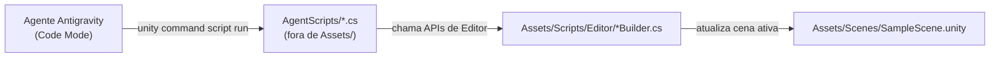

# Editor Tooling

Voltar ao indice: [[MOC]] | Relacionados: [[player-systems]], [[weapons-and-combat]], [[enemy-ai]], [[ui-and-hud]], [[unity-codemode-workflow]]

## Escopo

Scripts exclusivos do Unity Editor (`Assets/Scripts/Editor/`) usados para montar de forma reproduzivel a arena de teste (`SampleScene`), os inimigos, os prefabs de armas e a hierarquia completa do Canvas uGUI.

## Builders (`Assets/Scripts/Editor/`)

| Arquivo | Linhas | Menu / Funcao | O que Constroi |
| :--- | :---: | :--- | :--- |
| `TestArenaBuilder.cs` | 300 | `[MenuItem("Tools/Build FPAA Test Arena")]` | Monta a arena de teste completa em `SampleScene` (plataformas incluindo `Platform_High` a `2.2m`, parede com porta via `DoorArenaBuilder`, jogador, pedestal da escopeta, `MeleeEnemy` + `RangedEnemy` + `EnemyProjectilePool`, NavMesh e HUD) |
| `DoorArenaBuilder.cs` | 215 | Helper estatico | Constroi `WallWithDoor` (`10m x 4m`) com batente, `Door_Pivot`, `Door_Leaf` (`DoorController` + `NavMeshObstacle` + `NavMeshModifier`), macanetas e materiais URP persistentes em `Assets/Materials/Arena/` |
| `HUDCanvasBuilder.cs` | 277 | Helper estatico | Cria o Canvas uGUI principal, `CrosshairHUD`, `SlingshotChargeHUD` e `StaminaBarUI`, ligando referencias |
| `AmmoHUDBuilder.cs` | 126 | Helper estatico | Constroi o painel de municao (`AmmoHUD`) e conecta ao inventario/armas |
| `HealthHUDBuilder.cs` | 93 | Helper estatico | Constroi a barra de vida (`PlayerHealthBarUI`) e vincula a `PlayerHealth` |
| `EnemyBuilder.cs` | 156 | Helper estatico | Instancia `MeleeEnemy` (`80 HP`), `RangedEnemy` (`60 HP` com materiais URP persistentes em `Assets/Materials/Enemies/`) e `EnemyProjectilePool` sob `ShootPools` |
| `SlingshotPrefabGenerator.cs` | 99 | `[MenuItem("Tools/Generate Slingshot Prefab")]` | Gera `Assets/Prefabs/Slingshot_Viewmodel.prefab` |
| `TestCubeCreator.cs` | 22 | Helper estatico | Utilitario minimo de criacao de cubo de teste |

## Relacao com Code Mode

## Saude Tecnica

- **Debito tecnico registrado (KI-01)**: `TestArenaBuilder.cs` possui **307 linhas**. Caso novas areas ou obstaculos sejam adicionados a arena, separar a construcao de geometria da configuracao de entidades.
- Sempre que um Editor estiver aberto, prefira acionar builders ou editar a cena via [[unity-codemode-workflow]] em vez de editar arquivos `.unity` ou `.prefab` manualmente em texto.
