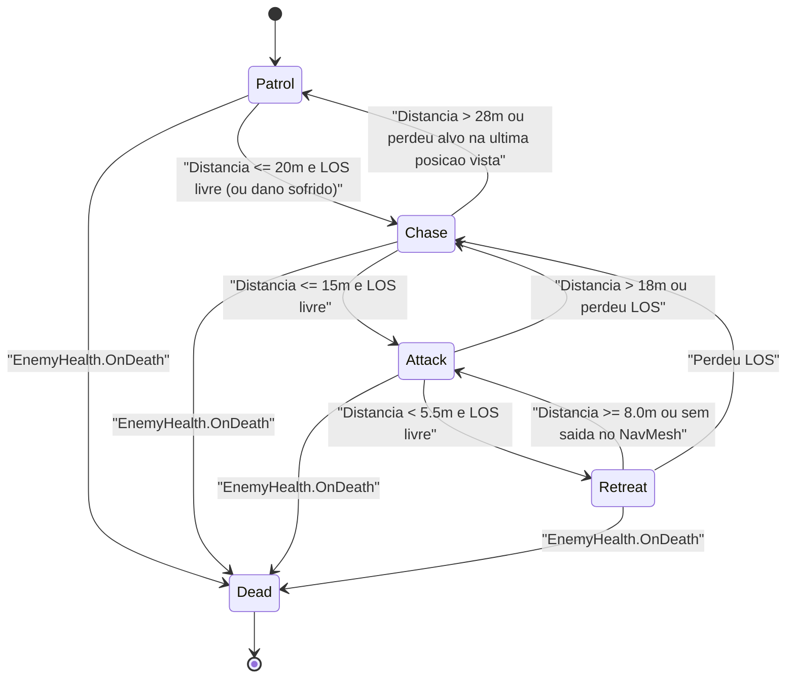

# Enemy AI

Voltar ao indice: [[MOC]] | Relacionados: [[player-systems]], [[weapons-and-combat]], [[editor-tooling]]

## Escopo

Controla inimigos corpo a corpo e a distancia com navegacao baseada em `NavMeshAgent` (`com.unity.ai.navigation` `2.0.15`), percepcao com linha de visao (LOS), posicionamento tatico (patrulha, perseguicao, ataque, recuo), pooling de projeteis inimigos e ciclo de dano/morte via `IDamageable`.

## Componentes (`Assets/Scripts/Enemy/`)

| Arquivo | Linhas | Responsabilidade | API / Eventos Principais |
| :--- | :---: | :--- | :--- |
| `EnemyMeleeAI.cs` | 254 | Maquina de estados `AIState` (`Idle`, `Patrol`, `Chase`, `Attack`) corpo a corpo sobre `NavMeshAgent`, com suporte a emboscada (`EnterAmbushIdle` / `StartRelentlessChase`) | `CurrentState`, `EnterAmbushIdle(...)`, `StartRelentlessChase(...)`, `TransitionToState(...)` |
| `EnemyMeleeAnimator.cs` | 112 | Sincroniza `EnemyMeleeAI` com o `BonecaEnemy.controller` (`AnimState`: `0 = Idle` 120-165, `1 = Walk` 1-55, `2 = Run` 55-120) com `applyRootMotion = false` | `CurrentAnimState`, `BindAnimator(...)`, `ResolveAnimator()` |
| `EnemyRangedAI.cs` | 307 | Maquina de estados `RangedAIState` (`Idle`, `Patrol`, `Chase`, `Attack`, `Retreat`) com LOS, windup, recuo e suporte a encontro (`EnterEncounterIdle` / `StartRelentlessChase`) | `CurrentState`, `HasLineOfSight`, `IsFiring`, `EnterEncounterIdle(...)`, `StartRelentlessChase(...)`, `BindProjectilePool(...)` |
| `EnemyRangedAnimator.cs` | 99 | Sincroniza `EnemyRangedAI` com `MordomoEnemy.controller` (`AnimState`: `0 = Idle` 0-54, `1 = Walk` 102-143, `2 = Attack` 54-84) com `applyRootMotion = false` | `CurrentAnimState`, `BindAnimator(...)`, `ResolveAnimator()` |
| `EnemyPerception.cs` | 84 | Sensor de linha de visao (peito/cabeca) e amostragem de pontos de patrulha/recuo no `NavMesh` | `HasLineOfSight(...)`, `TrySamplePatrolPoint(...)`, `TrySampleRetreatPoint(...)` |
| `EnemyRangedVisuals.cs` | 173 | Modelo procedural distinto do `RangedEnemy` (armadura azul-petroleo, visor ambar, blaster + `FirePoint` + brilho de carregamento) | `EnsureVisuals(...)`, `SetMuzzleColor(...)` |
| `EnemyProjectile.cs` | 146 | Projetil fisico (`ContinuousDynamic`, sem gravidade) com `IgnoreCollision` pos-ativacao (`KI-05`), dano em `PlayerHealth` e reciclagem | `Launch(...)`, `Recycle()` |
| `EnemyProjectilePool.cs` | 124 | Pool reutilizavel de projeteis inimigos (padrao `20`) com materiais URP compartilhados | `Configure(prefab, 20)`, `SpawnProjectile(...)`, `ReturnToPool(...)` |
| `EnemyHealth.cs` | 153 | Vida do inimigo (`IDamageable`), flash visual de impacto e sinalizacao de morte | `MaxHealth`, `CurrentHealth`, `IsDead`, `SetMaxHealth(...)`, `RefreshRenderers()`, `TakeDamage(...)`, eventos `OnHealthChanged`, `OnDamageTaken`, `OnDeath` |

## Maquina de Estados (`EnemyRangedAI`)

## Notas de Integracao e Saude Tecnica

- `EnemyRangedAI` e `EnemyMeleeAI` exigem `[RequireComponent(typeof(NavMeshAgent))]` e `[RequireComponent(typeof(EnemyHealth))]`.
- `EnemyProjectile` ignora outros `EnemyHealth` (sem fogo amigo), ignora `DoorController`/`ShotgunPickup` e aplica dano somente em `PlayerHealth` ([[player-systems]]).
- Paredes, portas fechadas (`WallWithDoor`) e caixas de fisica bloqueiam tanto o sensor `EnemyPerception.HasLineOfSight` quanto os projeteis inimigos, funcionando como cobertura real.
- **KI-01 resolvido:** `EnemyMeleeAI.cs` foi modularizado (extraindo `EnemyMeleeAnimator.cs`) e reduzido de 307 para **254 linhas**; todos os scripts de inimigos estao abaixo de 300 linhas.
