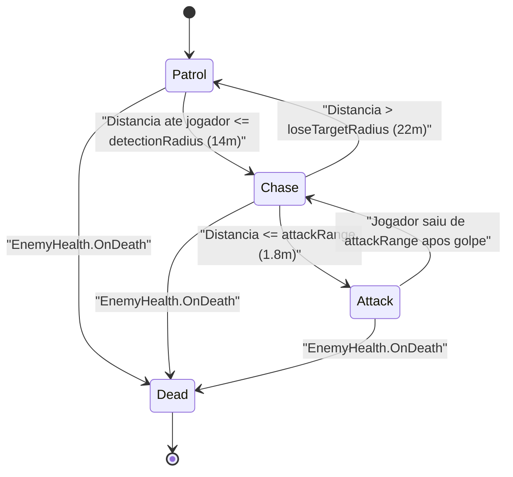

# Enemy AI

Voltar ao indice: [[MOC]] | Relacionados: [[player-systems]], [[weapons-and-combat]], [[editor-tooling]]

## Escopo

Controla inimigos corpo a corpo com navegacao baseada em `NavMeshAgent` (`com.unity.ai.navigation` `2.0.15`), patrulha em torno do ponto de spawn, perseguicao com histerese de raio e ciclo de dano/morte via `IDamageable`.

## Componentes (`Assets/Scripts/Enemy/`)

| Arquivo | Linhas | Responsabilidade | API / Eventos Principais |
| :--- | :---: | :--- | :--- |
| `EnemyMeleeAI.cs` | 307 | Maquina de estados `AIState` (`Patrol`, `Chase`, `Attack`) sobre `NavMeshAgent` | `CurrentState`, parametros `detectionRadius` (`14m`), `loseTargetRadius` (`22m`), `patrolRadius` (`12m`), `attackRange` (`1.8m`), `attackDamage` (`20`), `attackCooldown` (`1.2s`) |
| `EnemyHealth.cs` | 141 | Vida do inimigo (`IDamageable`), feedback de dano e sinalizacao de morte | `MaxHealth`, `CurrentHealth`, `IsDead`, `TakeDamage(...)`, eventos `OnHealthChanged`, `OnDamageTaken`, `OnDeath` |

## Maquina de Estados (`AIState`)

## Notas de Integracao e Saude Tecnica

- `EnemyMeleeAI` exige `[RequireComponent(typeof(NavMeshAgent))]` e `[RequireComponent(typeof(EnemyHealth))]`.
- Durante `Attack`, o dano e aplicado diretamente em `PlayerHealth.TakeDamage(...)` ([[player-systems]]).
- Recebe dano de `SlingshotProjectile` e `ShotgunPellet` atraves da interface `IDamageable` ([[weapons-and-combat]]).
- **Debito tecnico registrado (KI-01)**: `EnemyMeleeAI.cs` possui **307 linhas**. Na proxima alteracao de comportamento (ex: novos ataques ou animacoes), extrair o calculo de patrulha ou o modulo de ataque melee para uma classe separada.
