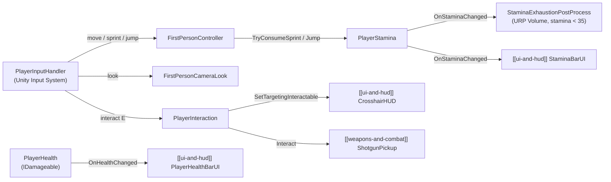

# Player Systems

Voltar ao indice: [[MOC]] | Relacionados: [[weapons-and-combat]], [[enemy-ai]], [[ui-and-hud]]

## Escopo

Concentra movimentacao em primeira pessoa, camera, leitura de input, stamina com pos-processamento de exaustao, saude com invulnerabilidade temporaria e deteccao de objetos interativos.

## Componentes (`Assets/Scripts/Player/` e `Effects/`)

| Arquivo | Linhas | Responsabilidade | API / Eventos Principais |
| :--- | :---: | :--- | :--- |
| `PlayerInputHandler.cs` | 209 | Ponte para o Unity Input System (`InputActionAsset`) | `JumpTriggered`, `IsSprinting`, `InteractTriggered`, `PrimaryActionTriggered/Held/Released`, `QuickSlot1Triggered`, `QuickSlot2Triggered`, `SetActionAsset(...)` |
| `FirstPersonController.cs` | 116 | Locomocao, corrida e salto acoplados a `PlayerStamina` | Consome `PlayerInputHandler` e `PlayerStamina` |
| `FirstPersonCameraLook.cs` | 98 | Rotacao de camera FPS, recuo vertical e trava do cursor | `AddRecoil(float pitchOffset)`, `LockCursor()`, `UnlockCursor()` |
| `PlayerStamina.cs` | 123 | Recurso de stamina (0-100), consumo em sprint/salto e estado de exaustao | `TryConsumeSprint`, `TryConsumeJump`, `RestoreStamina`, eventos `OnStaminaChanged`, `OnExhaustionChanged` |
| `PlayerHealth.cs` | 106 | Vida do jogador (`IDamageable`), janela de invulnerabilidade e respawn | `TakeDamage`, `Heal`, `SetRespawnPosition`, eventos `OnHealthChanged`, `OnPlayerDamaged`, `OnPlayerDied` |
| `PlayerInteraction.cs` | 115 | Raycast de interacao (tecla `E`, protegido contra duplo disparo de `Hold`) contra `IInteractable` e prompt no HUD | `BindCrosshairHUD(CrosshairHUD)` |
| `DoorController.cs` (`Interaction/`) | 176 | Porta articulada (`IInteractable`) com abertura suave para o lado oposto ao jogador e `NavMeshObstacle` dinamico | `IsOpen`, `Open`, `Close`, `Toggle`, `Configure(pivot, obstacle)` |
| `StaminaExhaustionPostProcess.cs` | 229 | Volume URP de exaustao (lens distortion, vignette, film grain) abaixo de stamina `35` | `CurrentWeight`, `TargetWeight`, `BindPlayerStamina(PlayerStamina)` |

## Fluxo de Dados

## Notas de Integracao

- `PlayerInteraction` depende apenas da interface `ProjectRac.Interaction.IInteractable` (`GetInteractionPrompt()`, `Interact()`), mantendo desacoplamento entre jogador, `InteractableTestObject` e `ShotgunPickup`.
- `PlayerHealth` implementa `ProjectRac.Combat.IDamageable`, recebendo dano direto de [[enemy-ai]] (`EnemyMeleeAI`) respeitando `IsInvulnerable`.
- `FirstPersonCameraLook.AddRecoil` e chamado pelas armas em [[weapons-and-combat]] para aplicar coice de camera.
