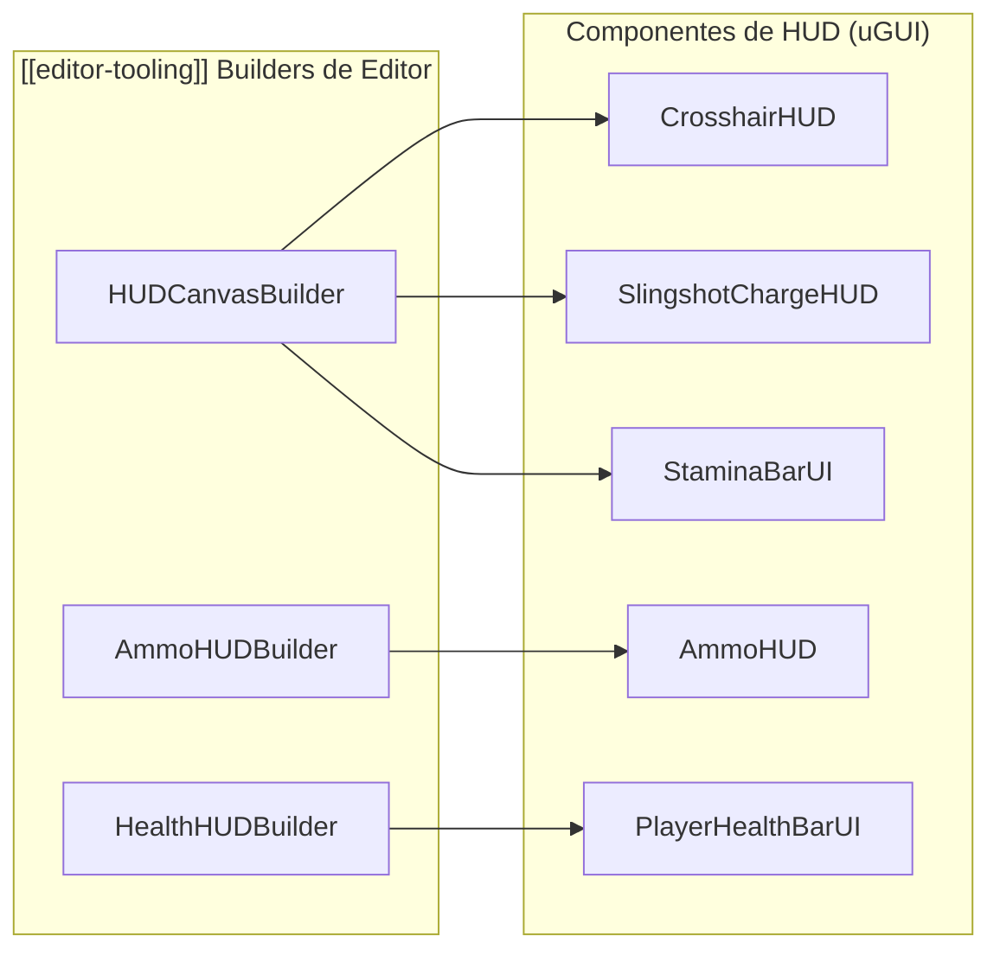

# UI and HUD

Voltar ao indice: [[MOC]] | Relacionados: [[player-systems]], [[weapons-and-combat]], [[editor-tooling]]

## Escopo

HUD em **uGUI** (`com.unity.ugui 2.6.0`) construido por builders de Editor e personalizavel diretamente no Inspector com sprites em `My project/Assets/Art/UI/`.

## Componentes (`Assets/Scripts/UI/`)

| Arquivo | Linhas | Responsabilidade | Fonte de Dados |
| :--- | :---: | :--- | :--- |
| `CrosshairHUD.cs` | 103 | Mira central, tamanho/sprite no Inspector e prompt de interacao | [[player-systems]] (`PlayerInteraction.BindCrosshairHUD`) |
| `AmmoHUD.cs` | 128 | Exibe nome da arma, municao atual/maxima e status de recarga | [[weapons-and-combat]] (`PlayerWeaponInventory`, `ShotgunWeapon`, `SlingshotWeapon`) |
| `SlingshotChargeHUD.cs` | 143 | Barra de carregamento do estilingue com sprites `bg`/`fill` customizaveis | [[weapons-and-combat]] (`SlingshotWeapon.BindChargeHUD`) |
| `PlayerHealthBarUI.cs` | 101 | Barra e texto de vida do jogador | [[player-systems]] (`PlayerHealth.OnHealthChanged`) |
| `StaminaBarUI.cs` | 221 | Barra de stamina com feedback visual de consumo e exaustao | [[player-systems]] (`PlayerStamina.OnStaminaChanged` / `OnExhaustionChanged`) |
| `NoteInspectionUI.cs` | 165 | Painel modal de leitura de notas (`E` / `Esc`) com bloqueio temporario de movimento, camera e armas | [[player-systems]] (`InspectableNote.Interact`) |
| `VisualNovelDialogueUI.cs` | 291 | Dialogo inicial estilo Visual Novel (caixa preta com borda branca, typewriter sem pulo, avanco por Clique Esquerdo/Espaco e skip opcional com `Esc`) | `VisualNovelDialogueData` / Custom Inspector |
| `VisualNovelDialogueData.cs` | 40 | Enum `CharacterSlot` (`None`/`Left`/`Center`/`Right`) e estrutura serializavel `VisualNovelDialogueLine` | Inspector (`VisualNovelDialogueUIEditor`) |
| `VisualNovelGameplayLock.cs` | 145 | Pausa `PlayerInputHandler` (anti-pulo/anti-tiro), movimento, camera, armas, viewmodel e HUD durante o dialogo VN | [[player-systems]], [[weapons-and-combat]] |
| `VisualNovelPortraitStage.cs` | 88 | Gerencia slots de sprites Left/Center/Right, escurecimento de quem nao fala e margens seguras do texto | `VisualNovelDialogueUI` |

## Sprites em `Assets/Art/UI/`

- `default_crosshair.png`
- `shotgun_icon.png`
- `slingshot_icon.png`
- `slingshot_charge_bg.png`
- `slingshot_charge_fill.png`
- `VN/vn_placeholder_maid.png`, `VN/vn_placeholder_guest.png`, `VN/vn_continue_arrow.png`

## Fluxo de Vinculacao (Binding)

## Padrao Arquitetural

- Todos os scripts de UI expoem metodos `Bind*` e `SetUGUIReferences` / `BindComponents` para injecao explicita pelos builders de Editor, evitando buscas caras (`FindObjectOfType`) a cada frame.
