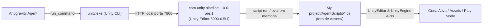

# Unity Code Mode Workflow

Voltar ao indice: [[MOC]] | Relacionados: [[editor-tooling]]

## Por Que Code Mode em Vez de MCP

O padrao **Code Mode** (descrito em `developers.cloudflare.com/agents/tools/codemode/`) substitui centenas de chamadas sequenciais de ferramentas MCP por execucao direta de codigo contra as APIs locais. No Unity 6 com `com.unity.pipeline`, isso elimina o custo de contexto de ~250 schemas MCP e evita domain reloads desnecessarios.

## Arquitetura da Conexao Local



## Comandos Essenciais

Sempre execute a partir de `My project` (ou passe `--project-path "C:\Users\hugob\OneDrive\Documentos\GitHub\joguin\Projeto-rac\My project"`):

```powershell
# 1. Confirmar Editor aberto e pronto
unity status --json --no-banner
unity command editor status --caller plugin --skill unity-cli --json --no-banner

# 2. Manter o Editor ativo mesmo sem foco antes de tarefas autonomas
unity command editor set_auto_tick --enabled true --caller plugin --skill unity-pipeline

# 3. Executar script C# em Code Mode (compila em memoria <2s, sem domain reload)
unity command script run --caller plugin --skill unity-pipeline --project-path "My project" --file AgentScripts/ProjectProbe.cs --entry ProjectProbe.Inspect --json --no-banner

# 4. Inspecao rapida de uma linha via script eval
unity command script eval --caller plugin --skill unity-pipeline --project-path "My project" "return UnityEditor.SceneManagement.EditorSceneManager.GetActiveScene().name;"

# 5. Verificar console (zero erros obrigatorio ao final)
unity command console status --caller plugin --skill unity-pipeline --json --no-banner
unity command console get --level error --caller plugin --skill unity-pipeline --json --no-banner
```

## Regras para `AgentScripts/`

1. **Mantenha fora de `Assets/`**: `My project/AgentScripts/` evita que o Unity reimporte ou dispare domain reload quando o agente itera em scripts de automacao ou diagnostico.
2. **Codigo em arquivo, nao em strings escapadas**: qualquer rotina acima de 2 linhas deve ir para um arquivo `.cs` em `AgentScripts/` e rodar com `script run`.
3. **Sem edicao manual de YAML**: com o Editor aberto (`state: ready`), todas as alteracoes de cena, prefab ou GameObject passam pelo Pipeline.

## Checklist de Sincronizacao: PC Principal vs. PC Secundario

| Item | Sincronizado pelo Git? | Acao ao trocar de PC |
| :--- | :---: | :--- |
| `docs/` (Second Brain) | Sim | `git pull` |
| `.agents/skills/rennan-dev-cycle/` | Sim | `git pull` |
| `.agents/skills.json` + `.agents/vendor/awesome-gamedev-agent-skills/` | Sim | `git pull` |
| `My project/Packages/manifest.json` (`com.unity.pipeline`) | Sim | Abrir projeto no Unity Editor |
| `My project/AgentScripts/` | Sim | `git pull` |
| `unity.exe` CLI | Nao (local) | Instalar uma vez com `irm https://unity.com/install.ps1 \| iex` |
| `~/.gemini/config/plugins/unity/` | Nao (local) | Rodar `unity setup antigravity` uma vez por maquina |
