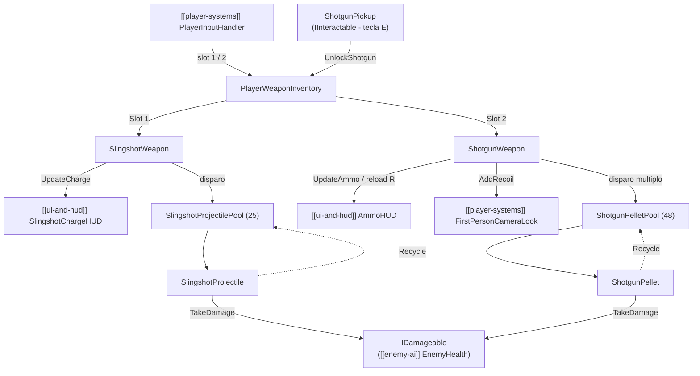

# Weapons and Combat

Voltar ao indice: [[MOC]] | Relacionados: [[player-systems]], [[enemy-ai]], [[ui-and-hud]], [[editor-tooling]]

## Escopo

Define os contratos de dano e armas, o inventario de 2 slots (`1` Estilingue, `2` Escopeta), o desbloqueio via pickup no cenario e o object pooling dos projeteis.

## Contratos (`Combat/` e `Weapons/`)

- `ProjectRac.Combat.IDamageable` (`Combat/IDamageable.cs`, 9L): `void TakeDamage(float amount, Vector3 hitPoint, Vector3 hitDirection)`
- `ProjectRac.Weapons.IWeapon` (`Weapons/IWeapon.cs`, 11L): `WeaponName`, `SlotIndex`, `IsEquipped`, `Equip()`, `Unequip()`

## Componentes (`Assets/Scripts/Weapons/`)

| Arquivo | Linhas | Responsabilidade | API Principal |
| :--- | :---: | :--- | :--- |
| `PlayerWeaponInventory.cs` | 139 | Gerencia slots `1` e `2`, troca ativa e desbloqueio da escopeta | `HasShotgun`, `ActiveSlot`, `CurrentWeapon`, `BindWeapons(...)`, `SelectSlot(int, bool)`, `UnlockShotgun(bool)` |
| `SlingshotWeapon.cs` | 223 | Arma inicial (slot 1) com carregamento continuo e disparo balistico | `ChargeNormalized`, `IsCharging`, `BindPool`, `BindAmmoHUD`, `BindChargeHUD`, `SetCustomViewmodelPrefab` |
| `SlingshotProjectilePool.cs` | 102 | Pool reutilizavel de projeteis do estilingue (padrao 25) | `Configure(prefab, 25)`, `ReturnToPool(SlingshotProjectile)` |
| `SlingshotProjectile.cs` | 131 | Fisica de impacto, aplicacao de `IDamageable` e reciclagem | `Launch(origin, velocity, pool, owner)`, `Recycle()` |
| `ShotgunWeapon.cs` | 295 | Escopeta (slot 2) com dispersao de pellets, recarga (`R`), recuo e `ShootPoint` | `CurrentAmmo`, `MaxAmmo`, `IsReloading`, `ShootPoint`, `BindReferences`, `StartReload` |
| `ShotgunPelletPool.cs` | 130 | Pool reutilizavel de pellets da escopeta (padrao 48) | `Configure(prefab, 48)`, `ReturnToPool(ShotgunPellet)` |
| `ShotgunPellet.cs` | 146 | Trajetoria visual/fisica do pellet, isolamento de colisao entre pellets e dano | `Launch(origin, direction, pool, owner)`, `Recycle()` |
| `ShotgunPickup.cs` | 95 | Objeto coletavel no pedestal (`IInteractable`), restrito a tecla `E` | `ResolveWorldModel()`, `GetInteractionPrompt()`, `Interact()` |
| `ShotgunModelGenerator.cs` | 55 | Construcao procedural do modelo 3D da escopeta quando sem prefab customizado | Helpers estaticos de geracao |

## Fluxo de Combate e Pooling

## Restricoes Tecnicas

- `ShotgunWeapon.cs` esta em **295 linhas** (5 linhas abaixo do limite de 300L da regra `rennan-dev-cycle`). Novas mecanicas (ex: efeitos sonoros ou animacoes complexas) devem ser delegadas a componentes auxiliares.
- `ShotgunPellet` evita colisao mutua entre pellets disparados no mesmo tiro para manter a dispersao consistente.
